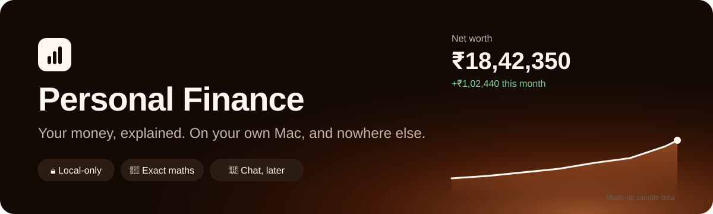
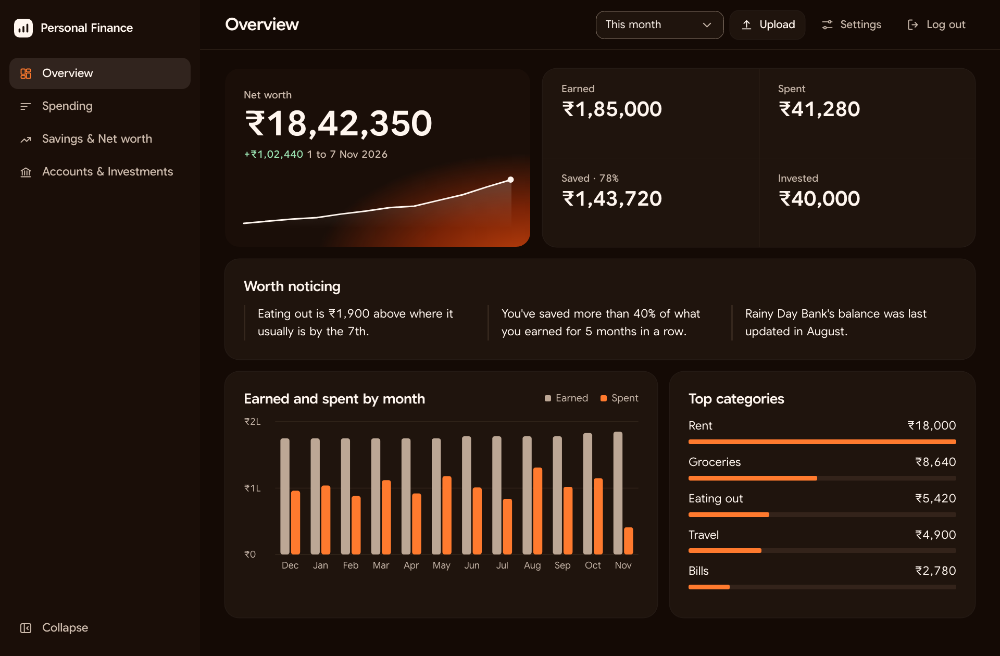
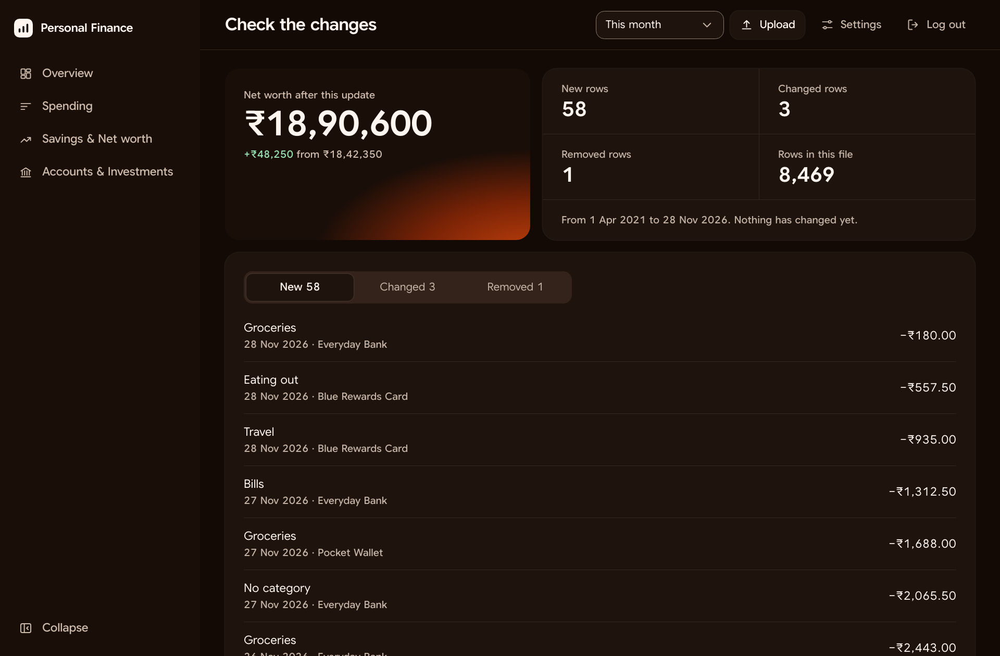
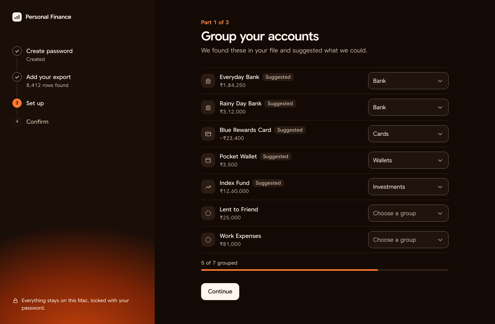
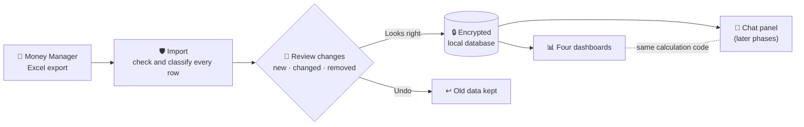
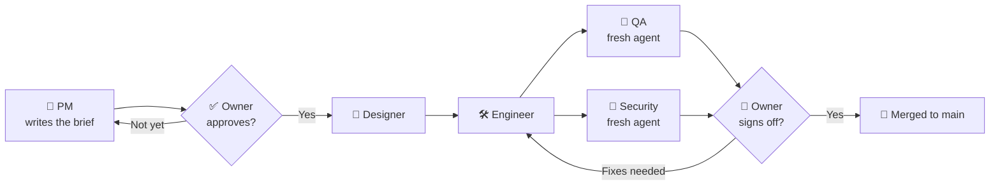
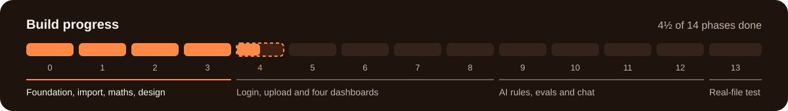

<p align="center">
  
</p>

<p align="center">
  
  
  
  
  
</p>

<p align="center">
  <b>A private money dashboard that runs only on your own Mac.</b><br>
  It turns a phone app's Excel export into clear answers, and later lets you chat about them,<br>
  without your data ever going to a company's server.
</p>

---

## ✨ A first look



| 🔍 Check every change before it replaces your data | ⚡ Set up in minutes, with suggestions from your own file |
|---|---|
|  |  |

> [!NOTE]
> These are design previews with made-up data. The import, the money calculations and the design of every screen are finished. In the running app so far, you can create a password, log in, lock it and delete your data. Upload and the dashboards come next.

## 🧭 What it does



| | Feature | In one line |
|---|---|---|
| 📥 | **Import** | Reads the full export from Money Manager, checks it and classifies every row |
| 📊 | **Four dashboards** | Overview, Spending, Savings & Net worth, and Accounts & Investments |
| ↩️ | **Safe updates** | Each new export replaces the old data only after you've seen what changes. One click undoes it |
| 💬 | **Chat** *(later)* | A side panel that uses the same calculations as the dashboards, with your own Claude or OpenAI key |

It only reads and explains. Nothing is entered or edited in the app.

## 🤔 Why it exists

Money Manager is great for logging and weak for analysis. Every alternative costs something:

| Option | The catch |
|---|---|
| 📄 Spreadsheets | Slow to keep up, and they break when the export changes |
| ☁️ Finance apps | Your full financial history sits on someone else's server |
| 🤖 Pasting into a chatbot | The AI does the arithmetic, so the answers can't be trusted |

So the product makes **three bets**:

> **1. Trust beats features.** If one figure looks wrong, the owner stops using the app. Every rupee of a net worth change is explained, line by line.
>
> **2. One set of definitions.** The dashboards and the chatbot call the same calculation code, so they can't disagree. The AI never does the arithmetic.
>
> **3. Private by default.** Local-only, encrypted and password-locked. Nothing leaves the Mac unless you add an AI key.

## 🏗️ How it's being built: an AI product team

The owner is a non-technical product manager, and AI agents do the building. The interesting part is the operating model: AI agents are run like a small product team, with clear roles and checks.



| Practice | How it works | Why it matters |
|---|---|---|
| 🧩 **Small phases** | 14 phases, each ending in something that can be checked | Mistakes stay small and cheap |
| 🎭 **Seven personas** | PM, AI PM, Designer, Engineer, AI FDE, QA and Security, each with its own written skill | Each job has one owner and one definition of done |
| ✋ **Owner approval gate** | Nothing is designed or built until the owner accepts the brief in chat, even in auto mode | The human keeps the product decisions |
| 🕵️ **Independent checks** | QA and Security run as fresh agents with no build history | Nobody marks their own homework |
| 📋 **Written criteria** | Every phase has numbered acceptance criteria, and each gets a recorded result | "Done" is evidence, not opinion |
| 💰 **Budget per phase** | Each phase has a usage budget. Work stops at the line and asks | AI cost is managed like any other product cost |
| 🛡️ **Data guard** | Hooks and checks block spreadsheets, databases and secrets. All test data is generated | Real data can't reach the repo or the AI during the build |
| 🎨 **Design system first** | One system decides how every screen looks. Changes go to it, never to a single screen | Screens stay consistent, and later phases can't drift |

Decisions are logged as they happen. There are 25 so far, in [`docs/DECISIONS.md`](docs/DECISIONS.md).

## 📈 Progress so far



| Phase | What it delivered | Result |
|---|---|---|
| ✅ 0. Foundation | Encrypted database, GitHub, data guard, security baseline | Merged after sign-off |
| ✅ 1. Sample data and import | Generated test data, and a hardened file reader | QA's first run found 1 Blocker and 3 Majors, all closed before merge |
| ✅ 2. Setup and metrics | Earned, spent, saved and net worth logic | QA passed all 27 criteria, with no Blocker or Major |
| ✅ 3. Flows and screens | 16 screens specified, a design system, 3 clickable previews | 23 criteria checked and owner signed off. Security caught 2 Blockers and 6 Majors, all fixed |
| ✅ 4A. Getting in safely | Create password, log in with slow-down, auto-lock, the app shell, delete my data, the forgotten-password wipe | QA found 1 Blocker, fixed and re-tested. Security signed off with no Blocker or Major. Owner signed off |
| ✅ 4B. Upload and setup | First upload, setup with your own income and expense groups, summary, update with preview, one-step encrypted undo | QA passed all 19 criteria with no Blocker or Major. 6 small QA issues and 2 small security issues fixed and re-checked. Security and owner signed off |
| 🔜 5 to 8 | The four dashboards | Next |
| 🗓️ 9 to 12 | AI rules and evals, then provider, tools and chat | Planned |
| 🗓️ 13 | Final hardening, and the owner's real-file check | Planned |

Today: **479** automated tests passing · **0** known dependency vulnerabilities · a clean data guard.

### 🎯 What the process has caught

- **A merge that looked fine.** QA's first Phase 1 run blocked it. The core held up against hostile files; the faults were at the edges.
- **"Looks like a prototype."** The owner rejected the first screens. That led to a real design system and a written quality bar, before any screen was built.
- **Bugs caught while still just words.** In Phase 3, Security found the app could say "You're logged out" with the session still live, and a half-finished delete could leave the app stuck. Fixing a sentence is far cheaper than fixing code.
- **A small Blocker before it shipped.** In Phase 4A, QA found the date pickers in "Choose a period" overlapping on wide windows. It was fixed and re-checked by a fresh QA agent before merge.
- **A change of mind, handled by the gate.** In Phase 4B, the owner saw the setup preview and found the Earned, Returns and Loan labels too complicated. Work paused, the brief and designs were redrawn, and only after the owner's yes was the simpler version built: their own income and expense groups.
- **A budget line that worked.** Phase 3 ran from 50 to 90 points. Work stopped at the line, and the owner chose to raise it. Design took more than planned, a useful input for later phases.

### ⚠️ Known limits, stated plainly

- The dashboards aren't built yet. You can log in, upload an export, group your accounts, income and expenses, review an update and undo it, but Overview is still a placeholder.
- All income counts as Earned, so a loan or investment gain logged as income makes the savings rate look higher that month. The owner accepted this to keep setup simple.
- Nothing has been tested on real data, on purpose, until Phase 13.
- There's no password reset, because a reset would be a back door. A forgotten password means starting again from the latest export.
- Backups of the Mac can still hold old encrypted copies after a delete.

## 🏁 How success is measured

> [!IMPORTANT]
> **The one test that matters most.** In the final phase, the owner uploads the real file and compares 5 account balances and the total against Money Manager. Any gap is the first thing to fix. It's the only test that uses real data, and only the owner runs it.

<details>
<summary><b>What has to be true, area by area</b></summary>

| Area | What has to be true |
|---|---|
| 🧮 **Numbers** | On generated data, row counts, transfer pairs and every figure match expected values. The net worth breakdown adds up exactly for any period |
| 📤 **Upload** | The same file shows no changes. An edited copy shows the right differences. Undo restores the old data. Wrong or partial files are stopped or warned about |
| 🔐 **Security** | While locked, the database can't be read and no page returns data. A search of the repo and its history finds no spreadsheets, databases or secrets |
| 🖥️ **Experience** | Every screen has designed loading, empty, error and stale states. It works at 1280, 375 and 320 pixels wide, by keyboard, and in light and dark |

</details>

<details>
<summary><b>How the AI will be evaluated</b></summary>

The AI rules and evals are written in Phase 9, before any chat is built, and need the owner's approval.

- About 10 questions with known answers run on both Claude and OpenAI, and must match the dashboard exactly.
- Attacks through the Notes text, and requests for buy or sell calls, must both fail.
- The chatbot's tools are read-only, and a local log shows exactly what was sent to the provider.
- A spend cap limits the cost.

</details>

## 🗺️ Where to look

| To see | Open |
|---|---|
| 📘 The full product plan | [`docs/PROJECT_BRIEF.md`](docs/PROJECT_BRIEF.md) |
| 📏 The quality bar | [`CONSTRAINTS.md`](CONSTRAINTS.md) |
| 🔄 How a phase runs | [`docs/phases/README.md`](docs/phases/README.md) |
| 🔬 An example of the full process | [`docs/phases/phase-3/`](docs/phases/phase-3/): brief, design, security review and handoff |
| 🎨 The design system | [`docs/design-system/README.md`](docs/design-system/README.md) |

## 🚀 Run it

You need Node 25.8.0 (see `.nvmrc`) or Node 24.7 or newer.

**1. Set up once** after cloning. It installs dependencies and turns on the data guard's git hooks:

```bash
npm run setup
```

**2. Build and start** the app, then open http://127.0.0.1:3000:

```bash
npm run app
```

<details>
<summary><b>🧪 Checks</b></summary>

```bash
npm test
```

```bash
npm run typecheck
```

```bash
npm run prove:encryption
```

```bash
npm run guard
```

</details>

## 📜 Rules for this repo

- 🙅 Your real export and anything taken from it stay out of this project. Tests generate made-up data when they run.
- 🛡️ The git hooks and the pull request check block spreadsheets, databases and secrets.
- 🌿 Each phase gets its own branch and pull request, merged only after your sign-off.
- 🗒️ Decisions are logged in `docs/DECISIONS.md`.
